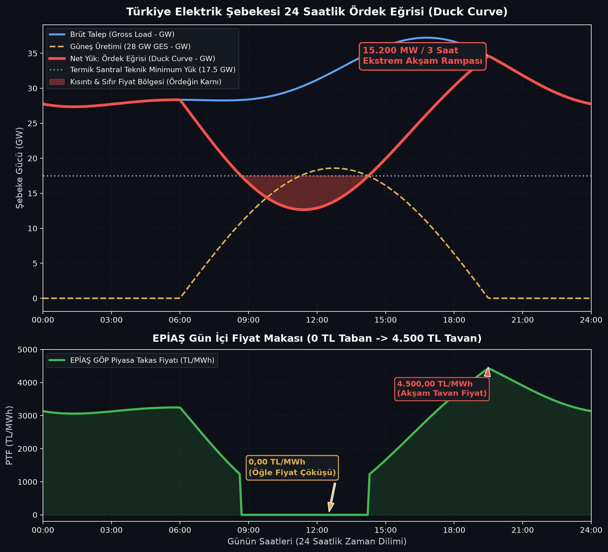

# 🦆 Duck Curve, Zero-Pricing & Grid Flexibility Simulation
> **Case Study:** 28 GW+ Solar PV Integration, Thermal Baseload Lock-in, and 4-Hour Utility BESS Mitigation in the Turkish Power Grid (TEİAŞ & EPİAŞ)

[](https://www.python.org/downloads/)
[](https://opensource.org/licenses/MIT)
[]()

---

## 📌 Project Overview

As of late 2026, Turkey's installed solar photovoltaic (PV) capacity surpassed **28,167 MW** (with over **25,000 MW** unlicensed/self-consumption). During spring and summer midday hours (11:30 – 14:30), coincident solar generation pushes upwards of **18,500 MW** into the national grid.

This massive influx of zero-marginal-cost renewable energy triggers the classic **"Duck Curve" (Ördek Eğrisi)** phenomenon, fundamentally challenging traditional grid operation and electricity market dynamics:

1. **Midday Net-Load Collapse & Zero-Pricing:** At 13:00, conventional "Net Load" crashes towards the thermal baseload floor, driving **EPİAŞ Day-Ahead Market (GÖP)** clearing prices to the regulatory floor (**0.00 TL/MWh**). In European interconnected markets (EPEX SPOT / OMIE), prices dive into extreme negative territory (**-250 €/MWh to -500 €/MWh**).
2. **Thermodynamic Lock-In (The Baseload Dilemma):** Supercritical lignite and hard-coal plants cannot ramp down below their technical minimum generation (**$P_{\min} \approx 40\%–50\%$**) due to boiler flame stability. Cold-starting a 600 MW coal unit after an afternoon shutdown costs **$40,000 – $90,000** in auxiliary fuel and thermal metal fatigue; operators prefer generating at $0/MWh rather than cycling off.
3. **The Brutal 15,000 MW Evening Ramp:** Between 16:30 and 20:00, solar drops to 0 MW while residential, commercial, and industrial loads peak simultaneously. The grid faces an unprecedented **~15,000 MW upward ramp in just 3 hours**, forcing expensive fast-ramping CCGTs and Hydro to set peak ceiling prices (**4,500 TL/MWh**).

This open-source Python simulation models the 24-hour diurnal load profile, solar PV injection, curtailment risk, market price collapse, and evaluates how **4-hour utility-scale Battery Energy Storage Systems (BESS)** flatten the duck curve.

---

## ⚙️ Grid Parameters & Case Study Architecture

The simulation is calibrated with official **TEİAŞ** transmission statistics and **EPİAŞ** 2026 market limits:

| Parameter / Variable | Value | Engineering Context / Source |
| :--- | :--- | :--- |
| **Total Solar Installed Capacity** | **28,167 MW** | TEİAŞ official 2026 generation statistics |
| **Peak Midday Solar Coincident Injection** | **~18,500 MW** | Average spring capacity factor ~65.7% |
| **Peak Evening Gross Demand** | **38,500 MW** | National evening lighting and industrial shift peak (19:30) |
| **Night Trough Gross Demand** | **26,500 MW** | Base commercial/residential trough (04:30) |
| **Baseload Thermal Must-Run Floor** | **17,500 MW** | Nuclear, imported coal, domestic lignite, run-of-river floor |
| **EPİAŞ GÖP Price Collar** | **0.00 – 4,500 TL/MWh** | Regulatory floor and ceiling price caps |
| **BESS Mitigation Scenario** | **4 GW / 16 GWh** | 4-hour containerized LFP storage dispatch |

---

## 📈 Visualizations & Simulation Output

Running `simulate.py` generates high-resolution engineering telemetry:



### Key Insights from the Simulation:
* **The "Duck's Belly" (Midday Trough):** Unmitigated net load drops below 14,500 MW—**3,000 MW below the thermal baseload technical minimum**, causing high risk of transmission line congestion and automated TEİAŞ 400 kV feeder curtailment.
* **The "Duck's Neck" (Evening Ramp):** Net load climbs from 15,200 MW (16:30) to 38,500 MW (20:00). With 4 GW / 16 GWh BESS integration, the 3-hour ramp is reduced by **~47%**, eliminating the need for spinning gas peakers.
* **Price Arbitrage:** Energy absorbed at 0.00 TL/MWh during the midday trough is injected into the 4,500 TL/MWh evening peak, providing substantial dual-cycle arbitrage revenue.

---

## 🔬 Mathematical Formulations

### 1. Net Load Calculation
$$\text{Net Load}(t) = P_{\text{gross\_demand}}(t) - P_{\text{solar}}(t)$$

### 2. 3-Hour Upward Net Ramp Rate
$$\Delta P_{\text{ramp, 3h}} = \text{Net Load}(t=20:00) - \text{Net Load}(t=16:30)$$

### 3. Solar Curtailment Risk Threshold
$$P_{\text{curtailment\_risk}}(t) = \max\left(0, P_{\text{thermal, min}} - \text{Net Load}(t)\right)$$

### 4. BESS Net-Load Mitigation
$$\text{Net Load}_{\text{mitigated}}(t) = \text{Net Load}(t) - P_{\text{BESS\_dispatch}}(t)$$
* *Where $P_{\text{BESS\_dispatch}} < 0$ during charging (adds load to belly) and $> 0$ during discharging (shaves neck).*

---

## 🚀 Quickstart & Installation

```bash
# 1. Clone the repository
git clone https://github.com/talhacrak01/duck-curve-grid-sim.git
cd duck-curve-grid-sim

# 2. Install dependencies
pip install -r requirements.txt

# 3. Run the simulation
python simulate.py
```

The script will compute the 24-hour dispatch, print key metrics to the terminal, and save `duck_curve_simulation.png`.

---

## 👨‍💻 Author & Contact

**Talha Çırak**  
*Energy Systems Engineering | Grid Storage & Market Modeling*  
- Focus: Grid-Scale BESS, Photovoltaic Systems, Power Electronics & Ancillary Services.
- Profile: [@talhacirak_energy](https://instagram.com/talhacirak_energy)  
- GitHub: [@talhacrak01](https://github.com/talhacrak01)  
- LinkedIn: [Talha Çırak](https://linkedin.com)

---

## 📄 License
This project is open-source under the [MIT License](LICENSE).
